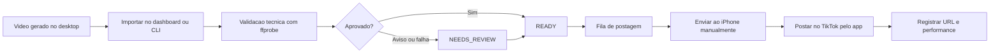

# Pipeline de Conteudo TikTok Shop

Os dados oficiais de pedidos, GMV, comissoes e atribuicao por `content_id` sao descritos em `docs/tiktok-shop-creator-api.md`.

Este modulo organiza a producao, o estoque e a fila de videos do TikTok Shop sem automatizar postagem no TikTok. O objetivo e deixar o desktop preparar tudo e o iPhone executar a postagem manual.

## Fluxo operacional



## O que foi implementado

- Estoque local de videos em `data/content/<PREFIXO>/<CODIGO>.mp4`.
- Deduplicacao por SHA-256 para evitar importar o mesmo video duas vezes.
- Estados controlados: `DRAFT`, `PROCESSING`, `NEEDS_REVIEW`, `READY`, `QUEUED`, `SENT_TO_PHONE`, `PUBLISHED`, `FAILED`, `ARCHIVED`.
- Fila de postagem com prioridade e data agendada.
- Endpoint para abrir o proximo video publicavel.
- Registro manual de performance por video: views, pedidos, GMV e comissao.
- Sincronizacao segura com Google Drive/Sheets quando as variaveis estiverem configuradas.
- Modo fallback local para Drive em `data/google_drive_mirror`.

## Dashboard

Inicie o servidor:

```powershell
python dashboard_server.py
```

Acesse:

```text
http://127.0.0.1:8765
```

Na aba `Conteudo`:

- importe um MP4 por upload ou caminho local;
- veja a validacao tecnica;
- aprove videos em `NEEDS_REVIEW`;
- coloque videos em fila;
- copie legenda e hashtags;
- abra o proximo video para envio manual ao iPhone;
- marque `Enviado ao iPhone` e depois `Publicado`.

## CLI

Importar video:

```powershell
python manage_content.py import --product-id 1 --path "C:\Videos\video.mp4" --caption "Legenda" --hashtags "#tiktokshop" --batch "Gera Viral 01"
```

Colocar na fila:

```powershell
python manage_content.py queue --content-id 1 --priority 80 --scheduled-date 2026-08-09
```

Consultar proximo:

```powershell
python manage_content.py next
```

Marcar como enviado ao iPhone:

```powershell
python manage_content.py sent --content-id 1
```

Marcar como publicado:

```powershell
python manage_content.py published --content-id 1 --tiktok-url "https://www.tiktok.com/@perfil/video/123"
```

Registrar performance:

```powershell
python manage_content.py performance --content-id 1 --views 1200 --orders 3 --gmv 210 --commission 31.5
```

## Configuracao

Crie um `.env` local a partir de `.env.example`, se for usar Google Drive, Google Sheets ou um caminho especifico de `ffprobe`.

```text
GOOGLE_APPLICATION_CREDENTIALS=
GOOGLE_DRIVE_ACCOUNT_EMAIL=ceciliafigueiredo.shop@gmail.com
GOOGLE_DRIVE_TIKTOK_ROOT_FOLDER_ID=1XA8zgZNAMjhRvonypu1hb7cm3b9iX4Gc
GOOGLE_DRIVE_LOCAL_MIRROR=data/google_drive_mirror
GOOGLE_SHEETS_PUBLISHING_QUEUE_ID=
FFPROBE_BIN=ffprobe
```

Sem credenciais Google, o sistema nao falha: ele registra evento `PENDING_CONFIG` e usa uma copia local quando aplicavel.

A origem ativa validada em 2026-08-08 e a pasta `FLOW` da conta `ceciliafigueiredo.shop@gmail.com`. A aplicacao usa uma conta de servico dedicada com permissao de Leitor na raiz; a credencial privada permanece fora do repositorio.

## Google Drive e Sheets

O servico `GoogleDriveService` esta preparado para:

- criar ou reutilizar uma referencia por video;
- mover conteudos entre pastas conceituais como `Ready`, `Published` e `Archive`;
- gravar eventos idempotentes em `external_sync_events`.

O servico `GoogleSheetsQueueService` registra a intencao de sincronizar a fila. Quando as credenciais e o ID da planilha forem configurados, este ponto pode ser expandido para escrita real em ranges.

## Limites de automacao

Este projeto nao deve:

- postar automaticamente no TikTok;
- usar emulador, ADB, Appium ou automacao visual do app;
- burlar login, captcha, rate limit ou fluxo do TikTok;
- fazer scraping nao autorizado.

O limite correto e preparar arquivo, legenda, fila, Drive/Sheets e checklist. A acao de postar no TikTok Shop fica manual no iPhone.
