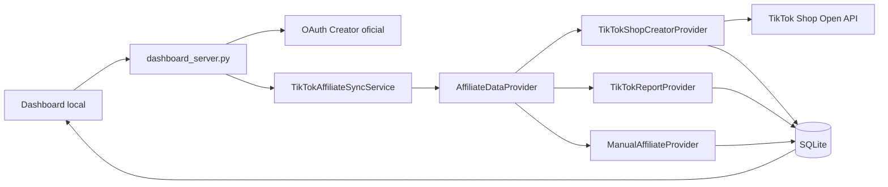

# TikTok Shop Creator API

Extensao do pipeline existente para pedidos, GMV e comissoes da conta Creator. O SQLite em `data/agent.db` continua sendo a fonte de verdade; Google Sheets permanece apenas como saida operacional auxiliar.

## Estado para o Brasil

Em agosto de 2026, Creator Collaboration para esse caminho esta marcado como `Not open` para BR. A operacao brasileira usa `TikTokReportProvider` e `ManualAffiliateProvider`; o `TikTokShopCreatorProvider` fica preservado e desativado:

```text
TIKTOK_SHOP_CREATOR_API_ENABLED=false
```

Nao e necessario continuar o onboarding ISV apenas para esta integracao. A flag deve permanecer `false` ate o caminho abrir oficialmente para BR e o aplicativo receber aprovacao, allowlist e escopos.

## Arquitetura



Nao ha scraping, controle de navegador, emulador ou API privada nesta integracao.

## APIs oficiais usadas

- Autorizacao Creator: `https://shop.tiktok.com/alliance/creator/auth`
- Token: `GET /api/v2/token/get`
- Refresh: `GET /api/v2/token/refresh`
- Perfil: `GET /affiliate_creator/202508/profiles`
- Pedidos afiliados: `POST /affiliate_creator/202410/orders/search`
- Base de producao: `https://open-api.tiktokglobalshop.com`

Escopos esperados:

```text
creator.affiliate.info
creator.affiliate_collaboration.read
```

Referencias oficiais: [Creator Authorization Guide](https://partner.tiktokshop.com/docv2/page/creator-authorization-guide), [Sign your API request](https://partner.tiktokshop.com/docv2/page/sign-your-api-request), [Search Creator Affiliate Orders](https://partner.tiktokshop.com/docv2/page/search-creator-affiliate-orders), [Get Creator Profile](https://partner.tiktokshop.com/docv2/page/get-creator-profile) e [Affiliate Integration](https://partner.tiktokshop.com/docv2/page/affiliate-integration).

## Operacao atual por relatorios

O dashboard importa o relatorio oficial TikTok Affiliate Orders em XLSX ou CSV de duas formas:

1. upload na aba `Integracao`;
2. deteccao automatica na pasta `data/affiliate_reports/inbox`.

O servidor verifica a pasta ao iniciar e depois a cada 300 segundos. Ele aguarda 30 segundos apos a ultima alteracao do arquivo para evitar ler uma exportacao incompleta. Esses valores podem ser ajustados em `.env`:

```text
AFFILIATE_REPORT_AUTO_IMPORT_ENABLED=true
AFFILIATE_REPORT_IMPORT_DIR=data/affiliate_reports/inbox
AFFILIATE_REPORT_IMPORT_INTERVAL_SECONDS=300
AFFILIATE_REPORT_MIN_AGE_SECONDS=30
DAILY_IMPORT_LOOKBACK_DAYS=30
```

Cada arquivo recebe SHA-256. O historico e os erros ficam em `affiliate_import_batches` e `affiliate_import_errors`. A interface permite preview e reprocessamento idempotente. Arquivos nao sao movidos, renomeados nem apagados.

Formato real, regras financeiras, matching e operacao diaria: `docs/tiktok-affiliate-orders-daily-import.md`.

Execucao avulsa, adequada ao agendador da operacao:

```powershell
python import_affiliate_reports.py
```

## Configuracao futura da API oficial

1. Copie as chaves de `.env.example` para um arquivo local `.env`.
2. Cadastre exatamente a URL de callback no Partner Center.
3. Preencha `TIKTOK_SHOP_APP_KEY` e `TIKTOK_SHOP_APP_SECRET`.
4. Confirme que o aplicativo recebeu os dois escopos Creator.
5. Altere `TIKTOK_SHOP_CREATOR_API_ENABLED=true` somente quando BR estiver oficialmente aberto e apos a aprovacao.
6. Reinicie `python dashboard_server.py` e use `Integracao > Conectar Creator`.

O servidor carrega `.env` sem substituir variaveis ja definidas no processo. O arquivo `.env` e ignorado pelo Git.

## Seguranca OAuth e tokens

- `state` aleatorio de 256 bits, armazenado apenas como SHA-256;
- validade padrao de 10 minutos;
- vinculo ao cookie de sessao `HttpOnly` e `SameSite=Lax`;
- consumo atomico e de uso unico no callback;
- tokens cifrados no SQLite com Windows DPAPI, vinculados ao usuario do Windows;
- `app_secret`, access token e refresh token nao sao enviados ao frontend, Sheets ou logs;
- refresh antecipado e lock por conta para evitar renovacoes concorrentes.

Se o banco for movido para outro usuario ou computador, os tokens DPAPI nao poderao ser abertos. Nesse caso, desconecte e autorize novamente.

## Sincronizacao

Sincronizacao manual:

```powershell
python sync_affiliate.py
```

Sincronizacao historica explicita:

```powershell
python sync_affiliate.py --full
```

O modo incremental parte de `last_sync_at` e recua a janela em 6 horas por padrao. Esse recuo absorve atualizacoes tardias de status, comissao e reembolso. A API e paginada em ate 100 pedidos por chamada; `provider + external_order_id` e a chave idempotente.

Para agendamento, use `python sync_affiliate.py` no agendador ja adotado pela operacao. Nao ative o agendamento enquanto a feature flag estiver `false`; o comando falhara de forma controlada.

## Associacao de produtos e conteudos

Produtos sao associados nesta ordem:

1. `products.tiktok_product_id` com o ID oficial do produto;
2. `products.tiktok_sku_id` com o ID oficial do SKU;
3. `ProductExternalReference` e associacao manual;
4. nome normalizado apenas como fallback unico.

Conteudos de Video so recebem vendas quando o Content ID coincide com `content_items.tiktok_video_id` ou existe associacao manual. Vitrine e Live permanecem separados. Sem match, o ID entra na tela de reconciliacao.

## Formato dos relatorios

O formato autoritativo atual possui 47 colunas em portugues. A deteccao usa o conjunto de headers e exige ID do pedido, ID do produto, tipo/ID do conteudo, GMV e data do pedido. Consulte `docs/tiktok-affiliate-orders-daily-import.md` para o mapeamento completo.

## Endpoints locais

- `GET /api/integrations/tiktok-shop/status`
- `GET /api/integrations/tiktok-shop/creator/authorize`
- `GET /api/integrations/tiktok-shop/creator/callback`
- `GET /api/integrations/tiktok-shop/affiliate-summary?days=30`
- `POST /api/integrations/tiktok-shop/sync`
- `POST /api/integrations/tiktok-shop/disconnect`
- `POST /api/integrations/tiktok-shop/csv/import`
- `POST /api/integrations/tiktok-shop/reports/preview`
- `POST /api/integrations/tiktok-shop/reports/process`
- `POST /api/integrations/tiktok-shop/reports/import`
- `GET /api/integrations/tiktok-shop/reconciliation`
- `POST /api/integrations/tiktok-shop/reconciliation/content`
- `POST /api/integrations/tiktok-shop/reconciliation/content-status`
- `POST /api/integrations/tiktok-shop/reconciliation/product`
- `POST /api/integrations/tiktok-shop/manual/order`
- `POST /api/integrations/tiktok-shop/product-match`

## Diagnostico

- `API_NOT_APPROVED`: aplicativo ainda nao liberado para Affiliate API.
- `MISSING_SCOPE`: reautorize depois de liberar os escopos requeridos.
- `TOKEN_EXPIRED`: refresh token expirou; autorize novamente.
- `NOT_CONNECTED`: token invalido, identidade incorreta ou conta desconectada.
- `ERROR`: consulte `last_error`, `affiliate_sync_runs` e `tiktok_api_requests`.

Erros transitorios de rate limit, timeout e servidor recebem retry exponencial limitado. O log de observabilidade guarda endpoint, request ID, codigo, duracao e contagem, nunca credenciais.
